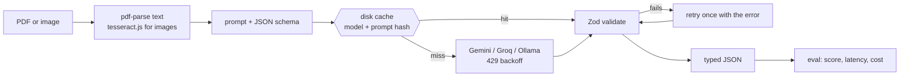

# DocParse

Invoice, insurance-policy and account-statement PDFs in, schema-validated JSON out, plus an eval harness that compares models on **accuracy, cost and latency**.

```bash
docparse extract invoice.pdf --model gemini
```

## Live demo

A small web page runs the same extractor on an uploaded PDF or one of three samples: `public/index.html` plus the serverless function `api/extract.ts` (Gemini free tier, 2 MB limit, 10 documents per hour per IP). Run it locally with `npm run demo`, or deploy the repo to Vercel and set `GEMINI_API_KEY`.

## Results

> **Status: pipeline verified, live model numbers not run yet.** The table below comes from a deterministic *simulated* model that reads the ground truth and injects errors, so it proves the scorer, cache and CI gate work, and says nothing about Gemini, Groq or Ollama. Run `npm run eval:live` with free-tier keys to fill in real rows, then commit `eval/cache/` and `eval/baseline.json`.

<!-- Regenerated by `npm run eval`; source: eval/results.md -->
| Model | Version | Field accuracy | Invoice | Policy | Statement | Schema pass | Pass 1st try | p50 ms | p95 ms | Est. cost/doc |
|---|---|---|---|---|---|---|---|---|---|---|
| simulated-strong (simulated) | simulated-strong-sim | 97.2% | 97.2% | 95.8% | 98.8% | 98.0% | 98.0% | 968 | 1457 | $0 |
| simulated-weak (simulated) | simulated-weak-sim | 87.6% | 87.6% | 89.8% | 85.3% | 88.0% | 66.0% | 2360 | 4347 | $0 |

50 synthetic documents (30 invoices, 15 policies, 5 statements), ground truth in `eval/fixtures/*.json`. Accuracy is per field: exact match for IDs and dates, one-cent tolerance for amounts, case/punctuation-insensitive for names. Cost is an estimate at list price; actual spend on free tiers is $0.

### CI gate

`npm run eval:check` fails if any model in `eval/baseline.json` loses more than 2 accuracy points. Demonstrated locally by raising the simulated error rate from 3% to 12%:

```
REGRESSION simulated-strong: baseline 97.25% -> 88.07% (limit: 2 points)
```

## How it works



- **Schemas** (`src/schemas`): `Invoice`, `PolicySummary`, `Statement` (Zod).
- **Providers** (`src/providers`): one `Provider` interface. Gemini, Groq (`gpt-oss-120b`, Qwen) and Ollama, each with 429 exponential backoff.
- **Cache** (`src/cache`): every response is stored by `sha256(model, system, prompt)`. CI is read-only: a cache miss fails instead of calling a model.
- **Extractor** (`src/extract`): validates against the schema and retries once, feeding back the validation error.

## Quick start

```bash
npm install
cp .env.example .env        # free-tier keys: Google AI Studio, Groq. Ollama needs no key
npm run dev -- extract eval/fixtures/inv-001.pdf --model gemini
```

| Command | What it does |
|---|---|
| `npm run eval` | Score cached/simulated models on all fixtures, write `eval/results.md` |
| `npm run eval:live` | Call the real models (free tiers), filling `eval/cache/` |
| `npm run eval:check` | Fail on a >2 point drop vs `eval/baseline.json` |
| `npm run demo` | Serve the web demo locally on :3000 |
| `npm run dataset` | Regenerate the 50 fixtures (seeded, reproducible) |
| `npm test` / `npm run lint` | 33 tests / ESLint with a 30-line function limit |

After a live run, add `--update-baseline` once to record the new baseline: `npm run eval:live -- --update-baseline`.

Free-tier rules baked in: responses cached to disk, CI never touches the network, 429s back off and retry, eval set stays at 50 documents.

## What I'd do next

1. **Run the live eval and publish real numbers.** The table above is simulated until then.
2. **Scanned PDFs.** OCR works on images, but a PDF with no text layer is rejected with an instruction to rasterize it first. Adding a PDF-to-image step would close that gap.
3. **Harder documents.** The fixtures are clean, templated, English-only PDFs. Real invoices have messy layouts, so accuracy on them will be lower than on this set.

## Licence

MIT
